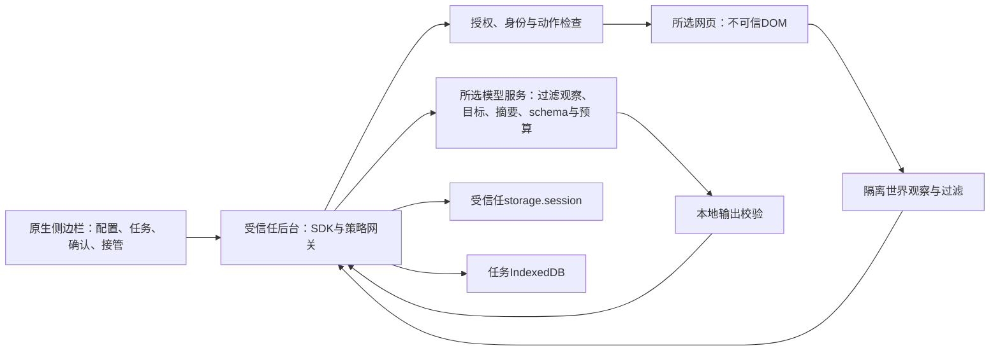

# 权限、数据流与存储

Wisp的观察、控制、策略和任务状态运行在浏览器扩展内。模型可以在本机或云端；选择远程服务时，经过过滤的页面信息会离开设备。过滤不等于匿名化，也不保证识别任意自由文本中的个人信息。

## Chrome权限与授权

| 权限 | 用途与边界 |
| --- | --- |
| sidePanel | 提供原生任务界面；普通扩展tab或网页不能伪造该上下文 |
| tabs | 读取标签页标题/地址以供选择；只有选定且获准的tab才能执行任务 |
| storage | 会话模型配置/授权/去重回执；任务数据库另用IndexedDB |
| debugger | 对所选tab观察、派发CDP输入并核对结果；Chrome会显示调试提示，断开后暂停 |
| 可选HTTP(S)主机权限 | 保存模型端点、授权站点时按需请求；manifest未预先授予所有站点访问权 |

Chrome主机匹配权限可能覆盖同一主机的多个端口，Wisp另核对精确origin（协议、主机、端口）。授权页面origin不等于授权另一个origin或模型端点。拒绝/撤销权限后不能继续执行，撤销会收紧授权并暂停。第一版只处理所选普通HTTP(S)tab；原生sender由后台校验，网页自报的id/url/source无效。

## 信息流

发给模型的内容包括：任务目标、当前URL/标题/有界文本、交互元素与普通字段值/下拉选项（允许范围内）、脱敏动作摘要、宿主完成条件、schema及预算。密码/验证码/识别为密钥的字段不暴露值，截断有标识；未支持内容可能被省略或转人工。任务文本和普通表单值本身可能含个人信息，请在输入前核对提供方与目标。

API密钥仅用于受信任宿主向所选提供方的鉴权请求，不送给目标网页、模型提示或任务trace。模型输出不能提供任意JavaScript，只能提出契约内的动作；本地仍会重新检查授权、目标身份和策略。页面提示注入属于不可信输入，当前约束降低风险，不构成对任意网站的绝对防御证明。

## 数据保存与删除

| 数据 | 位置与周期 |
| --- | --- |
| 扩展模型端点、模型名、API密钥 | 后台受信任storage.session的wispSession；保存后输入清空，读取只返回hasKey等元信息；清除配置先暂停，浏览器重启/扩展重载等会清除会话数据 |
| 精确origin授权、RPC去重回执 | 同一会话对象；去重与批准不是跨浏览器会话的永久授权 |
| 任务目标、状态、预算、schema摘要、宿主条件、动作日志、最终结果 | 扩展源IndexedDB（wisp-production-v01）；目标/最终结果可能含普通业务数据，不等于仅保存匿名元数据 |
| 原始DOM、模型原文、全量观察、普通输入值历史 | 不作为常规trace持久化；目标/最终提取结果可包含用户提交或提取的数据，不能据此声称数据库从不含字段值 |
| 开发验收报告/截图 | 仓库specs下evidence；与产品默认存储不同，探针可主动生成截图；分享前检查报告与工作目录 |

任务默认最多100条；运行时恢复/创建任务时清理满足条件的旧终态任务，通常以7天为保留阈值，容量压力下可更早删除最旧终态。它不是后台按时执行的7天物理删除任务。非终态或存在未解除unknown的任务不会被静默清理；空间不足会拒绝新任务。面板可删除允许清理的终态历史；清除模型配置不等于删除所有历史。

自定义SDK宿主决定其store位置和模型配置保管方式，内存store示例不提供重启持久化。不要把“扩展storage.session”承诺套用到任意第三方SDK宿主。

## 确认、停止与接管

提交、发送、删除、未知语义动作默认等待确认；付款、密码、验证码、授予权限转人工。批准绑定当前站点、文档、目标、参数、运行及有效期，只执行一次。字段/页面变化、过期、拒绝或撤销后不得执行原批准。

停止阻止后续动作、尽力中止外部请求；已发出的动作不保证可撤销，结果未知时保持屏障并核对。手动操作前先接管：Q-005尚不能可靠区分物理用户与程序输入，事件isTrusted不能证明物理用户身份；selectOption的合成事件明确不是可信用户事件。

真实模型补测如使用临时密钥，完成后在提供方控制台吊销，并清除本机环境变量/扩展会话配置。仅清除本地输入不会在服务端吊销密钥；不在对话或仓库留下密钥。其他已知限制见[支持范围](support.md)。
